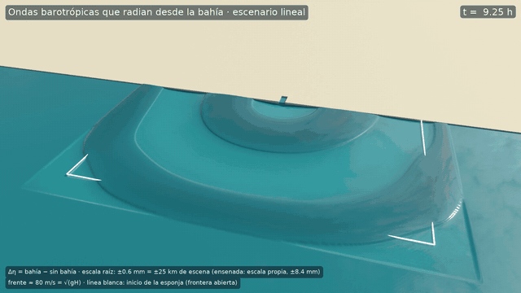
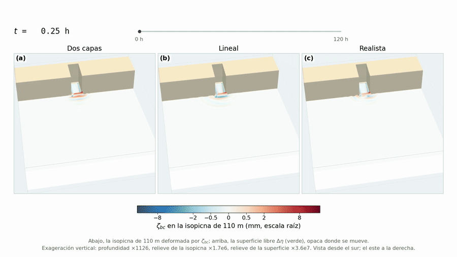
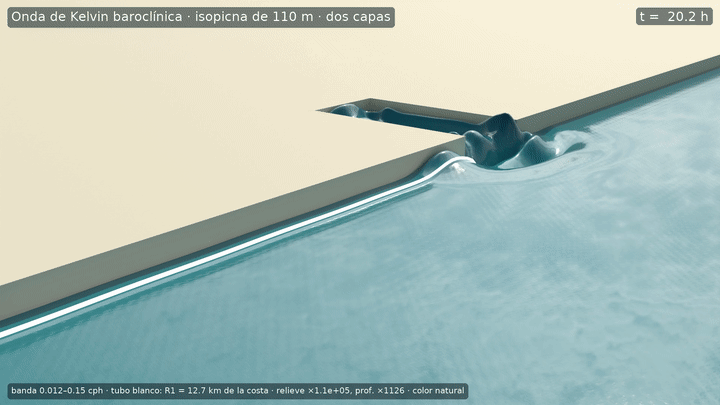
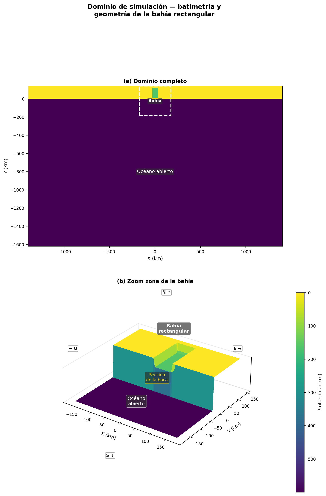

# Internal waves radiated by a wind-forced bay (MITgcm)



*Surface expression of the internal waves radiated by the bay (linear stratification, bay run minus no-bay run). The rings are the first baroclinic mode (λ ≈ 25 km, c₁ = 1.86 m/s); along the west coast travels an internal Kelvin wave. Labels in Spanish.*

MITgcm configuration and analysis for my M.Sc. thesis, *Estudio numérico de ondas internas generadas por un seiche en una bahía* (UNAM, 2026), advised by Dr. Ana Karina Ramos Musalem. Presented at the EGU General Assembly 2025.

**Question:** when wind sets a bay into a seiche, how much of that energy leaves as internal waves, and how does ocean stratification change the answer?

## Main results

A wind pulse over a bay excites a barotropic seiche and inertial oscillations, and both can radiate internal waves into the ocean. Three stratifications were run, each minus a no-bay control run, to isolate the bay's response.

| | Linear | Realistic (Feb, CASE) | Two-layer |
|---|---|---|---|
| Seiche decay time (period 3.8 h in all) | 8.3 h | 9.0 h | 9.9 h |
| Share of decay from barotropic→baroclinic conversion at the step | 18 % | 10 % | 1 % |
| Energy converted at the step (mostly before 25 h) | 0.39 GJ | 0.22 GJ | 0.05 GJ |
| Baroclinic energy through the mouth in 120 h | 1.06 GJ out | 0.28 GJ out | 0.17 GJ **in** |

- For the first ~30 h the bay radiates first-mode internal waves at the seiche frequency, fanning out from the step.
- After ~30 h the bay oscillates at 1.01–1.07 f. This near-inertial response leaves the corner of the mouth as a sloping beam and travels along the coast as an internal Kelvin wave.
- **The seiche is not the main pathway** by which the bay delivers baroclinic energy to the ocean: in the linear case, 86 % of the export happens after 30 h, in the near-inertial band. Stratification controls both pathways and can flip the mouth from exporting to importing energy.

<p align="center">
  
  
</p>

*Left: displacement of the 110 m isopycnal in the two-layer, linear and realistic scenarios; stratification sets which modes are excited and how far they reach. Right: baroclinic Kelvin wave travelling along the coast in the two-layer scenario.*



## Model setup

| | |
|---|---|
| Model | MITgcm, Cartesian grid |
| Bay | 121 km × 60.6 km, 163 m deep (Sebastián Vizcaíno Bay scale), connected by a step to a flat 600 m ocean |
| Horizontal grid | 560 × 352 cells, 5 km (stretched to 13.3 km near open boundaries) |
| Vertical grid | 50 levels, 1 m at the surface to 45.8 m at the bottom (~9 m at the 110 m pycnocline) |
| Time step | 30 s; 120 h total (forced 0–60 h, free 60–120 h) |
| Forcing | Gaussian wind patch, τ_max = 0.10 N m⁻², ends at 2.8 h |
| Boundaries | Orlanski radiation + 30-cell sponge on open boundaries; closed northern coast |
| Packages | OBCS, Diagnostics, MNC |
| Stratification | Linear · realistic (February 2008, California State Estimate, 121.3°W 27.6°N) · two-layer |

## Repository layout

This repository holds the **realistic-stratification** configuration. The linear and two-layer cases live in [BayIW_Rectan_linear](https://github.com/Estebanovich/BayIW_Rectan_linear) and [BayIW_Rectan_2layer](https://github.com/Estebanovich/BayIW_Rectan_2layer). Analysis notebooks (vertical modes, energy fluxes, spectra, wavelets, Hovmöller diagrams) are in [-IWBayMITgcm-postprocessing](https://github.com/Estebanovich/-IWBayMITgcm-postprocessing).

```
BayIW_Rectan/
├── code/                         # SIZE.h, packages.conf, OBCS_OPTIONS.h, DIAGNOSTICS_SIZE.h
├── input/                        # Notebooks/scripts that generate bathymetry, T/S and wind binaries
├── run_expand/                   # Run directory, with bay
├── run_expand_nobay/             # Run directory, control without bay
├── run_expand_pile*/ run_expand*_uniform/   # Sensitivity variants
├── compile_and_run_expand.sh     # Compile and run both cases
├── submit_*.slurm                # SLURM jobs for the Ometeotl cluster (UNAM)
└── docs/                         # Figures and animations used in this README
```

## Two-stage run

| Stage | `startTime` | `endTime` | `nIter0` | Wind | Purpose |
|---|---|---|---|---|---|
| 1, forced | 0 s | 216 000 s (60 h) | 0 | On (records every 20 min) | Wind pulse excites the seiche and internal waves |
| 2, free | 216 000 s | 432 000 s (120 h) | 7200 | Off | Free propagation and decay |

The committed `data` files correspond to stage 1. For stage 2, set in `&PARM03`:

```
startTime=216000., endTime=432000., nIter0=7200, pickupSuff='ckptA',
```

and comment out `meridWindFile`, `hydrogThetaFile` and `hydrogSaltFile` in `&PARM05`.

## How to run

Requirements: MITgcm source tree at `../../../`, `gfortran` (build options for `darwin_arm64_gfortran`) or the Intel optfile for Ometeotl, optional MPI, and Python 3 with numpy, netCDF4 and matplotlib.

```bash
bash compile_and_run_expand.sh     # asks about cleaning, MPI and core count; runs bay and no-bay cases
```

Single case:

```bash
cd run_expand
cp ../build/mitgcmuv .
mpirun -np 4 ./mitgcmuv > output.txt
```

Output is NetCDF in `mnc_*/`; the main diagnostic is `diag_rho` (density anomaly, every 900 s).

## Citation


Cruz Isidro, E. (2026). *Estudio numérico de ondas internas generadas por un seiche en una bahía* [M.Sc. thesis]. Universidad Nacional Autónoma de México.

Cruz Isidro, E., et al. (2025). EGU General Assembly 2025 abstract. <!-- completa autores, título y DOI del abstract EGU25 -->
